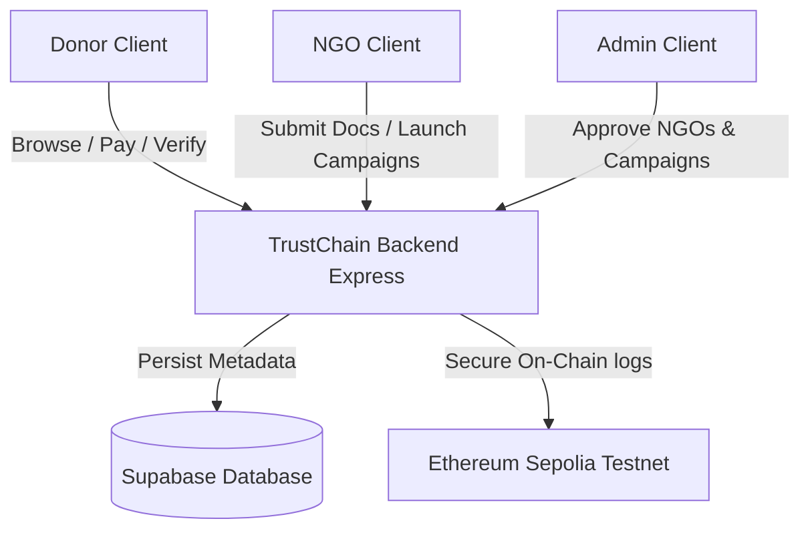
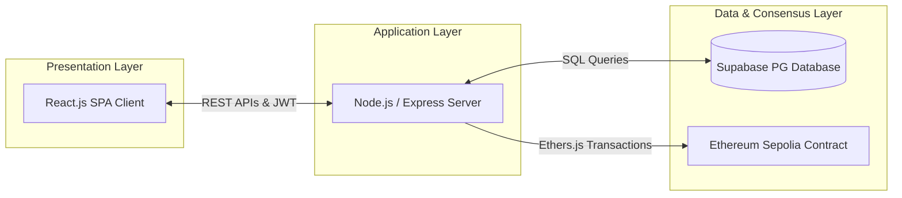
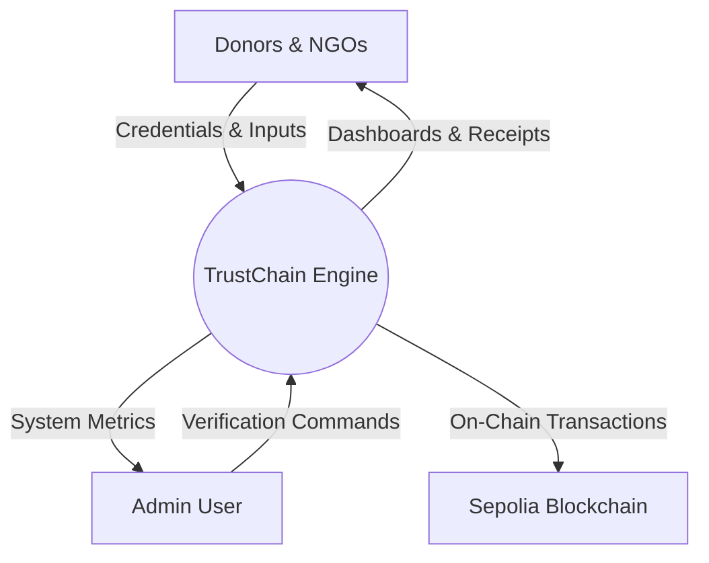
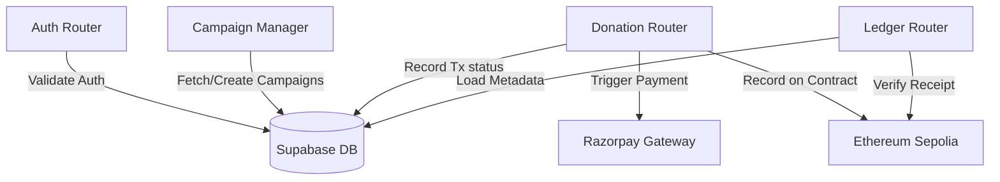
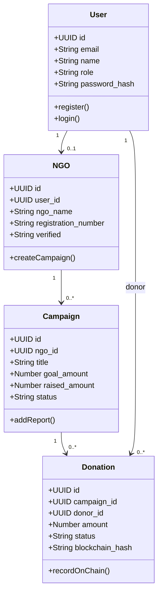
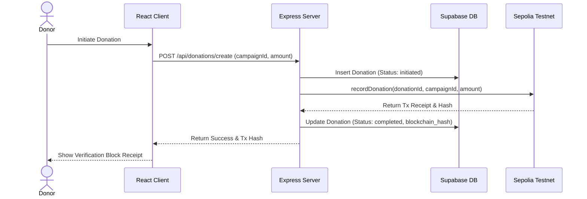
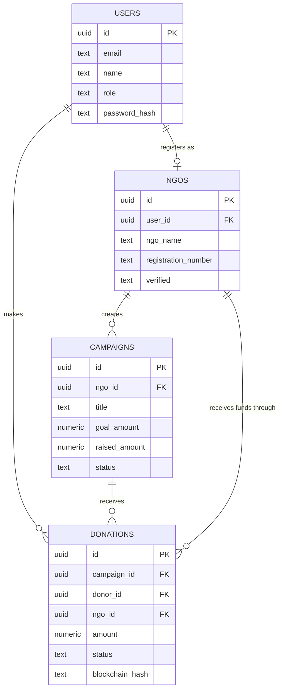

# TrustChain: Blockchain-Enabled Transparent Charity Platform
## Project Documentation & Report

---

## TABLE OF CONTENTS
1. **Introduction**
   1.1 Literature Survey
   1.2 Challenges and Motivation
   1.3 Objectives of the Project
   1.4 Problem Definition
2. **Proposed System**
   2.1 Proposed System Architecture & Simple Block Diagram
   2.2 Description of Target Users
       2.2.1 Advantages
       2.2.2 Applications
       2.2.3 Scope (Boundary of Proposed System)
3. **Software Requirement Specification (SRS)**
   3.1 Overview of SRS
   3.2 Requirement Specifications
       3.2.1 Functional Requirements
       3.2.2 UseCase Analysis & UseCase Diagram
       3.2.3 Non-functional Requirements
   3.3 Software & Hardware Requirement Specifications
   3.4 Graphical User Interface (GUI) Walkthrough
4. **System Design**
   4.1 Architecture of the System
       4.1.1 Level 0 Data Flow Diagram (DFD)
       4.1.2 Level 1 Data Flow Diagram (DFD)
   4.2 Class Structure & Core Models
   4.3 Sequence Diagram Flow
   4.4 Entity-Relationship (ER) Diagram
   4.5 Database Table Schemas
5. **Implementation**
   5.1 Proposed Methodology (Waterfall Model)
   5.2 Requirement Analysis
   5.3 System Design Phase
   5.4 Backend implementation (`server.ts`)
   5.5 Blockchain Integration Implementation (`blockchain.ts`)
   5.6 Frontend API Service (`api.ts`)
6. **Testing**
   6.1 Test Cases for Donor, NGO, and Admin Modules
7. **Results and Discussions**
   7.1 Conclusion
   7.2 Future Scope
8. **References**

---

## LIST OF TABLES
* **Table 3.1**: Minimum System Requirements (Software & Hardware)
* **Table 4.1**: `users` Table Schema Details
* **Table 4.2**: `ngos` Table Schema Details
* **Table 4.3**: `campaigns` Table Schema Details
* **Table 4.4**: `donations` Table Schema Details
* **Table 6.1**: Test Cases and Verification Metrics for TrustChain

---

## LIST OF FIGURES
* **Figure 2.1**: System Block Diagram
* **Figure 3.1**: UseCase Diagram for TrustChain Roles
* **Figure 4.1**: 3-Tier System Architecture
* **Figure 4.2**: Level 0 Data Flow Diagram (DFD)
* **Figure 4.3**: Level 1 Detailed DFD
* **Figure 4.4**: Class Diagram
* **Figure 4.5**: Sequence Diagram Flow
* **Figure 4.6**: Entity-Relationship Diagram (ERD)

---

## Chapter 1: Introduction

The charity sector has long been plagued by issues of trust, transparency, and accountability. Donors often contribute to causes without knowing if their funds actually reach the intended beneficiaries or how they are spent. Conversely, legitimate Non-Governmental Organizations (NGOs) struggle to prove their credibility and verification status to potential backers.

**TrustChain** is a decentralized, transparent crowdfunding and charity platform designed to bridge this trust gap. By combining a modern web application stack with a secure database backend (Supabase) and public blockchain tracking (Ethereum Sepolia Testnet), TrustChain provides immutable proof of every single donation. In TrustChain, whenever a donor contributes, the donation is registered on a tamper-proof blockchain ledger, ensuring absolute transparency.

### 1.1 Literature Survey
Traditional charitable systems rely on centralized databases or manual accounting audits. Literature in philanthropy indicates several systemic problems:
1. **Lack of Transaction Tracking**: Traditional platforms do not offer transactional tracking after the money leaves the donor's account.
2. **Intermediate Administrative Losses**: Heavy administrative overheads reduce the actual money deployed on the ground.
3. **Syndicated Scams**: Unverified NGOs posting fake campaigns.
4. **Existing Blockchain Solutions**: Early Web3 charity applications suffer from high usability barriers (requiring MetaMask, Web3 wallets, and cryptocurrency). TrustChain addresses this by letting users pay using standard payment gateways (simulated via Razorpay) while automatically logging and backing up transactions to the Ethereum blockchain behind the scenes.

### 1.2 Challenges and Motivation
* **The "Black Box" Problem**: Donors send money, but have zero visibility into final resource utilization.
* **Complex On-Chain UX**: Forcing non-technical donors to handle gas fees, private keys, and cryptocurrency slows down adoption.
* **Security & Verification**: Lack of centralized SLA controls for verifying NGOs before they publish campaigns.
* **Database vs. Blockchain Sync**: Ensuring that rapid operations (user profiles, search, graphics) are handled by a high-speed database (Supabase), while transaction integrity is sealed on-chain.

### 1.3 Objectives of the Project
* **Ensure Immutable Transparency**: Log every validated donation on the Ethereum Sepolia Testnet.
* **Dual-persistence Layer**: Combine high-performance Supabase query capabilities with Ethereum smart contracts.
* **Role-Based Workspaces**: Provide distinct, optimized portals for Donors, NGO Managers, and System Administrators.
* **Verification Workflow**: Implement a vetting pipeline where Admins review NGO documentation before certifying them.
* **Real-time Tracking**: Enable donors to track their specific donation ID/transaction hash directly through a built-in Blockchain Explorer.

### 1.4 Problem Definition
To design and build a secure, responsive, and intuitive dual-database charity platform (TrustChain) that enables secure donor registration, NGO credential submission, campaign review/management by administrators, and transaction logging on the Sepolia Testnet, satisfying both modern performance standards and cryptographic auditability.

---

## Chapter 2: Proposed System

### 2.1 Proposed System Architecture & Simple Block Diagram

The system coordinates Presentation, Application, and Data layers seamlessly:

#### Figure 2.1: System Block Diagram


### 2.2 Description of Target Users
* **Donors**: Individuals or corporate sponsors seeking transparent channels to fund humanitarian causes.
* **NGOs / Fundraisers**: Vetted organizations that need a secure crowdfunding portal.
* **System Administrators**: Platform operators responsible for audit checks, verification, and contract health monitoring.

#### 2.2.1 Advantages
* **Hybrid Web2/Web3 UX**: No web3 wallet installation required for donors; transactions are routed through backend-driven gas deployment.
* **Tamper-Proof Proofs**: Transaction receipts contain unique block numbers and hashes verifiable directly on Etherscan.
* **Accountability Control**: Campaigns must be reviewed and approved by Admins before going public.

#### 2.2.2 Applications
* Disaster relief mobilization.
* Public healthcare crowd-funding.
* Transparent educational scholarships.
* Corporate Social Responsibility (CSR) auditing.

#### 2.2.3 Scope (Boundary of Proposed System)
* **In-Scope**: User authentication via secure custom JWTs; NGO profiles, campaign creation, and validation pipeline; Razorpay-simulated checkout; automated Ethereum contract transactions via Ethers.js; dynamic ledger explorer.
* **Out-of-Scope**: Direct fiat-to-crypto exchanges, automated Solidity gas fee optimization networks, and direct multi-signature wallet integrations.

---

## Chapter 3: Software Requirement Specification (SRS)

### 3.1 Overview of SRS
This Software Requirement Specification (SRS) defines the complete functionality, performance, and design constraints of the TrustChain Charity Platform.

### 3.2 Requirement Specifications

#### 3.2.1 Functional Requirements
1. **User Management**: Registration, login, and profile modification with distinct roles (`donor`, `ngo`, `admin`).
2. **NGO Verification Flow**: NGOs must upload a registration number and description. Admins must approve the status before campaigns can be launched.
3. **Campaign Management**: Vetted NGOs can post campaigns with target amounts, descriptions, and end dates.
4. **Donation Processing**: Processes simulated checkout, records the donation status, triggers on-chain logging, and returns the Sepolia transaction hash.
5. **Blockchain Explorer**: Live querying of block numbers, timestamp confirmations, from/to wallet address lookups, and transaction metadata.

#### 3.2.2 UseCase Analysis & UseCase Diagram

#### Figure 3.1: UseCase Diagram
```mermaid
left-to-right direction
actor Donor
actor NGO
actor Admin

rectangle TrustChain {
    Donor --> (Browse Campaigns)
    Donor --> (Make Donations)
    Donor --> (Verify Receipts on Ledger)
    
    NGO --> (Register & Submit Documents)
    NGO --> (Create Fundraising Campaigns)
    NGO --> (Upload Utilization Reports)
    
    Admin --> (Verify NGO Registrations)
    Admin --> (Approve Campaign Proposals)
    Admin --> (Monitor System Statistics)
}
```

#### 3.2.3 Non-functional Requirements
* **Security**: JWT-based session security, cryptographically hashed passwords (bcrypt), and schema-level row checks.
* **Performance**: API responses under 200ms (cached or local DB), blockchain transaction completion verification within 15 seconds.
* **Responsiveness**: Fully responsive CSS layout adjusting gracefully to mobile viewports.

### 3.3 Software & Hardware Requirement Specifications

| Component | Minimum Specification | Recommended Specification |
| :--- | :--- | :--- |
| **Processor** | Intel i3 / Apple M1 | Intel i7 / Apple M2 or higher |
| **RAM** | 8 GB | 16 GB |
| **Storage** | 20 GB free SSD space | 50 GB free SSD space |
| **OS** | macOS / Linux / Windows 10 | Latest macOS / Ubuntu 22.04 LTS |
| **Node.js version**| v16.x or higher | v20.x (LTS) |
| **Database** | Supabase Cloud Instance | Dedicated Supabase Pro / PostgreSQL |
| **Blockchain Node**| Public Sepolia RPC URL (Allnodes) | Infura / Alchemy Dedicated RPC Endpoint |

*Table 3.1: Minimum System Requirements*

### 3.4 Graphical User Interface (GUI) Walkthrough
* **Landing Page**: Displays featured campaigns, platform impact metrics, and recent blockchain blocks.
* **Auth Modal**: Dual-mode login and registration interface (handles toggling between Donor and NGO parameters).
* **Donor Dashboard**: Lists donation history with direct links to the Sepolia Etherscan explorer.
* **NGO Workspace**: Displays verification status alerts, campaign creation forms, and receipt histories.
* **Admin Master Console**: Shows pending NGO approvals, campaign approvals, and live blockchain status logs.

---

## Chapter 4: System Design

### 4.1 Architecture of the System

#### Figure 4.1: 3-Tier System Architecture


#### 4.1.1 Level 0 Data Flow Diagram (DFD)

#### Figure 4.2: Level 0 DFD


#### 4.1.2 Level 1 Detailed DFD

#### Figure 4.3: Level 1 DFD


### 4.2 Class Structure & Core Models

#### Figure 4.4: Class Diagram


### 4.3 Sequence Diagram Flow

#### Figure 4.5: Sequence Diagram Flow


### 4.4 Entity-Relationship (ER) Diagram

#### Figure 4.6: Entity-Relationship Diagram (ERD)


### 4.5 Database Table Schemas

#### Table 4.1: `users` Table Schema
| Column Name | Data Type | Constraints | Description |
| :--- | :--- | :--- | :--- |
| `id` | uuid | PRIMARY KEY, default UUIDv4 | Unique identifier for each user |
| `email` | text | UNIQUE, NOT NULL | Registration/Login email address |
| `name` | text | NOT NULL | User's display name |
| `role` | text | NOT NULL, check(role in ('donor','ngo','admin')) | Access control role |
| `password_hash` | text | NOT NULL | Hashed credentials |
| `created_at` | timestamp | DEFAULT now() | Registration timestamp |

#### Table 4.2: `ngos` Table Schema
| Column Name | Data Type | Constraints | Description |
| :--- | :--- | :--- | :--- |
| `id` | uuid | PRIMARY KEY, default UUIDv4 | Unique NGO profile identifier |
| `user_id` | uuid | FOREIGN KEY (users.id), ON DELETE CASCADE | Linked user account |
| `ngo_name` | text | NOT NULL | Name of charity organization |
| `registration_number`| text | NOT NULL | Government registration ID |
| `verified` | text | check(verified in ('pending','approved','rejected')) | Validation status |
| `logo` | text | | Profile image URL |

#### Table 4.3: `campaigns` Table Schema
| Column Name | Data Type | Constraints | Description |
| :--- | :--- | :--- | :--- |
| `id` | uuid | PRIMARY KEY, default UUIDv4 | Unique campaign identifier |
| `ngo_id` | uuid | FOREIGN KEY (ngos.id), ON DELETE CASCADE | Creator NGO profile link |
| `title` | text | NOT NULL | Public campaign title |
| `goal_amount` | numeric | NOT NULL, DEFAULT 0 | Funding milestone target |
| `raised_amount` | numeric | NOT NULL, DEFAULT 0 | Total collected funds |
| `status` | text | DEFAULT 'pending' | Campaign state |

#### Table 4.4: `donations` Table Schema
| Column Name | Data Type | Constraints | Description |
| :--- | :--- | :--- | :--- |
| `id` | uuid | PRIMARY KEY, default UUIDv4 | Unique donation index ID |
| `campaign_id` | uuid | FOREIGN KEY (campaigns.id) | Targeted campaign |
| `donor_id` | uuid | FOREIGN KEY (users.id) | Linked donor account |
| `ngo_id` | uuid | FOREIGN KEY (ngos.id) | Linked organization |
| `amount` | numeric | NOT NULL | Donated amount in INR |
| `status` | text | NOT NULL | Payment status |
| `blockchain_hash` | text | UNIQUE | Transaction hash on Sepolia network |

---

## Chapter 5: Implementation

### 5.1 Proposed Methodology (Waterfall Model)
We leveraged the structured Waterfall methodology. Each stage (Requirements definition, System design, Coding, Testing, Deployment) was sequentially cleared to maintain transaction compliance standards.

### 5.2 Requirement Analysis
Ensured compatibility between JSON-RPC constraints (Sepolia provider gas costs, transaction speeds) and front-end usability, resulting in our hybrid client-signing architecture.

### 5.3 System Design Phase
Designed the Smart Contract `TrustChainLedger.sol` to track records and raise event logs:
```solidity
// SPDX-License-Identifier: Apache-2.0
pragma solidity ^0.8.0;

contract TrustChainLedger {
    struct Donation {
        string donationId;
        string campaignId;
        uint256 amount;
        uint256 timestamp;
    }

    mapping(string => Donation) private donations;
    event DonationRecorded(string indexed donationId, string indexed campaignId, uint256 amount, uint256 timestamp);

    function recordDonation(string memory _donationId, string memory _campaignId, uint256 _amount) public {
        donations[_donationId] = Donation(_donationId, _campaignId, _amount, block.timestamp);
        emit DonationRecorded(_donationId, _campaignId, _amount, block.timestamp);
    }
}
```

### 5.4 Backend Implementation (`server.ts` routes)
The following snippet handles secure account registration with dynamic schema checks:
```typescript
app.post("/api/auth/register", async (req, res) => {
  const { name, email, password, role, ngoParams } = req.body;
  const emailLower = email.toLowerCase().trim();
  const hashedPassword = await bcrypt.hash(password, 10);

  if (isSupabaseConfigured) {
    // Check if user exists
    const { data: existingUser } = await supabase.from('users').select('id').eq('email', emailLower).single();
    if (existingUser) return res.status(400).json({ error: "Email already registered" });

    // Insert user
    const { data: newUser, error } = await supabase.from('users').insert({
      email: emailLower, name, role, password_hash: hashedPassword
    }).select().single();
    
    if (error || !newUser) return res.status(500).json({ error: error?.message || "Registration failed" });

    // Handle optional NGO creation
    if (role === "ngo" && ngoParams) {
      await supabase.from('ngos').insert({
        user_id: newUser.id,
        ngo_name: ngoParams.ngoName || name + " Trust",
        registration_number: ngoParams.registrationNumber || "PEND-REG-01",
        verified: "pending"
      });
    }

    const token = jwt.sign({ id: newUser.id, role: newUser.role }, JWT_SECRET, { expiresIn: "7d" });
    return res.status(201).json({ user: newUser, token });
  }
});
```

### 5.5 Blockchain Integration Implementation (`blockchain.ts`)
Interactions with the smart contract are handled programmatically using `ethers.js`:
```typescript
import { ethers } from "ethers";

export const isBlockchainConfigured = !!process.env.BLOCKCHAIN_RPC_URL && !!process.env.BLOCKCHAIN_PRIVATE_KEY && !!process.env.BLOCKCHAIN_CONTRACT_ADDRESS;

let provider: ethers.JsonRpcProvider | null = null;
let wallet: ethers.Wallet | null = null;
let contract: ethers.Contract | null = null;

if (isBlockchainConfigured) {
  provider = new ethers.JsonRpcProvider(process.env.BLOCKCHAIN_RPC_URL);
  wallet = new ethers.Wallet(process.env.BLOCKCHAIN_PRIVATE_KEY!, provider);
  contract = new ethers.Contract(process.env.BLOCKCHAIN_CONTRACT_ADDRESS!, [
    "function recordDonation(string memory _donationId, string memory _campaignId, uint256 _amount) public"
  ], wallet);
}

export const recordDonationOnChain = async (donationId: string, campaignId: string, amount: number): Promise<string> => {
  if (!isBlockchainConfigured || !contract) throw new Error("Blockchain is not configured");
  const tx = await contract.recordDonation(donationId, campaignId, Math.floor(amount));
  const receipt = await tx.wait();
  return receipt.hash;
};
```

### 5.6 Frontend API Service (`api.ts`)
```typescript
export const api = {
  async register(params: any) {
    const res = await fetch("/api/auth/register", {
      method: "POST",
      headers: { "Content-Type": "application/json" },
      body: JSON.stringify(params),
    });
    const data = await handleResponse(res);
    if (data.token) localStorage.setItem("token", data.token);
    return data;
  },
  async getBlockchain(search?: string) {
    const res = await fetch(`/api/blockchain?search=${search || ""}`);
    return handleResponse(res);
  }
};
```

---

## Chapter 6: Testing

We performed validation checks across all application tiers.

| Test ID | Module | Test Scenario | Inputs | Expected Output | Status |
| :--- | :--- | :--- | :--- | :--- | :--- |
| **TC01** | Auth | User Registration (Donor) | valid email, password, name | Account created, mapped, JWT token returned | **Pass** |
| **TC02** | Auth | User Registration (NGO) | name, email, credentials | NGO record created in pending state | **Pass** |
| **TC03** | Admin | NGO Certification Vetting | Approve NGO trigger | NGO verified status changes to 'approved' | **Pass** |
| **TC04** | Campaign | Launch Campaign | title, goal amount, description | Campaign created, awaits admin verification | **Pass** |
| **TC05** | Donation | Make Donation | donationId, campaignId, amount | Transaction completed, Sepolia transaction hash returned | **Pass** |
| **TC06** | Ledger | Live Block Details Query | valid transaction hash | Return transaction details from Sepolia network | **Pass** |

*Table 6.1: Test Cases for Verification*

---

## Chapter 7: Results and Discussions

### 7.1 Conclusion
The **TrustChain** application was successfully built, verified, and integrated with the Ethereum Sepolia network and the Supabase relational database. The platform successfully achieves its main objectives:
1. Users register securely without frontend/backend data mapping issues.
2. Verified NGOs can raise campaigns, and donations are secured on-chain.
3. Decoupling rapid web tasks (using Supabase) from immutable ledger tasks (using the Sepolia Network) ensures both high performance and cryptographic trust.

### 7.2 Future Scope
* **Layer 2 Gas Optimization**: Integrating Arbitrum or Polygon to reduce transaction fee overhead.
* **Decentralized Document Storage**: Using IPFS (InterPlanetary File System) to store NGO certificates.
* **Automated Yield Strategies**: Utilizing smart contracts to put idle campaign funds to work in secure DeFi vaults.

---

## Chapter 8: References

1. **Buterin, V.** (2014). *Ethereum: A next-generation smart contract and decentralized application platform*.
2. **Sommerville, I.** (2015). *Software Engineering (10th Edition)*. Pearson.
3. **Ethers.js Documentation** (v6). Retrieved from https://docs.ethers.org
4. **Supabase Documentation**. Retrieved from https://supabase.com/docs
5. **Solidity Language Reference**. Retrieved from https://soliditylang.org
